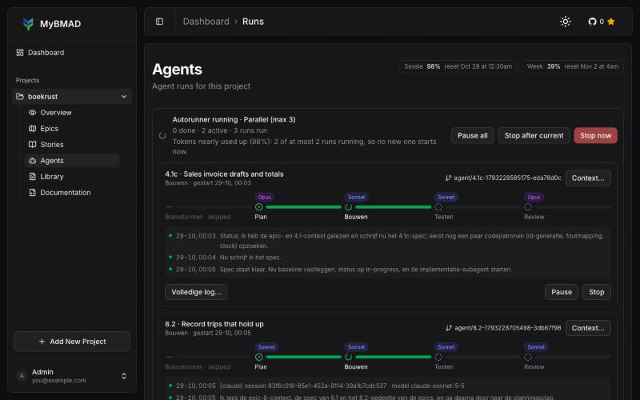
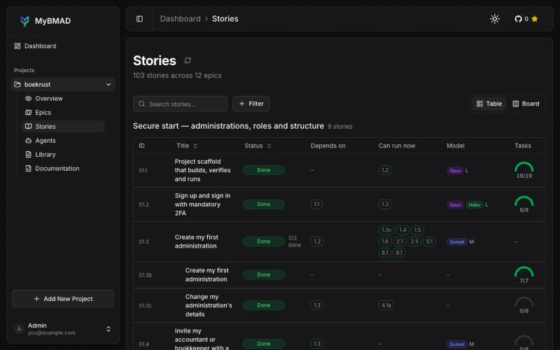
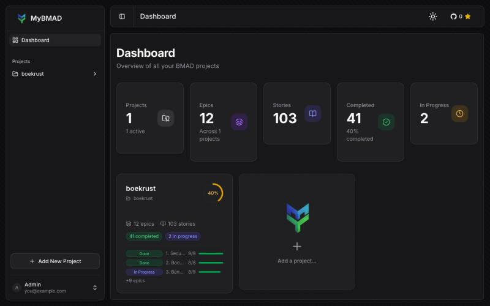

# MyBMAD Dashboard

A web dashboard - https://mybmad.hichem.cloud/ - to visualize and track [BMAD (Breakthrough Method of Agile AI-Driven Development)](https://github.com/bmad-method/bmad-method) projects from your GitHub repositories — or directly from local folders.

> **License:** MIT — see [LICENSE](./LICENSE) for details.

---

## Table of Contents

- [What is MyBMAD Dashboard?](#what-is-mybmad-dashboard)
- [Tech Stack](#tech-stack)
- [Quick Start](#quick-start)
- [Project Structure](#project-structure)
- [Available Scripts](#available-scripts)
- [Production Deployment](#production-deployment-docker)
- [Epic and Story Naming](#epic-and-story-naming)
- [Documentation](#documentation)
- [Contributing](#contributing)
- [License](#license)

---

## What is MyBMAD Dashboard?

MyBMAD Dashboard connects to your GitHub repositories (or local folders), reads the BMAD project structure (epics, stories, sprint status, docs), and displays everything in a clean, real-time dashboard. It is designed for solo developers and small teams who use the BMAD methodology with AI coding agents.

**Key features:**
- Import any GitHub repository that follows the BMAD structure
- **Import local folders** — no GitHub needed for self-hosted setups ([learn more](./docs/LOCAL_FOLDER.md))
- Visualize epic progress and story status at a glance
- Support for chunked epics (individual files in `epics/` directory) as well as a single `epics.md`
- Browse BMAD docs and planning artifacts directly in the app
- Track sprint status and velocity metrics
- Repo settings modal to switch branches directly from the UI
- Email/password authentication and optional GitHub OAuth login
- Multi-user support with an admin panel for the instance owner (`SUPER_ADMIN_EMAIL`)
- Self-hostable with Docker and automatic TLS via Traefik

---

## What is new in this fork

This fork adds agent management on top of the dashboard: start and monitor Claude Code runs per
story, and let an autorunner work through the backlog. The screenshots below are from this fork.

- **Agent runs per story:** start dev and review runs with Claude Code, plan a story up to
  `ready-for-dev`, and choose the BMAD agent or skill and the model for each action. Each run card
  shows start time, duration, model and cost, and can be paused or stopped.
- **Autorunner:** a project-wide queue that runs stories one at a time (optional), with *Stop now*
  and *Stop after current*. It paces its starts by the plan quota Claude reports, shows the session
  and week limits at the top of the agents page, can keep the computer awake, and can split large
  stories into subtasks first (optional).
- **Run visibility:** a context panel per run with the story's artifacts, changed files and readable
  diffs; a headline-only log with a full log dialog; and a Claude account per project.
- **Stories:** a board and a table view, a *Can run now* column, the stories that wait on each story,
  and split subtasks nested under their parent with a done count. A split story cannot be started
  as a single run.
- **Documentation:** a Documentatie tab, open-as-HTML buttons for specs, and `.html` files rendered
  in the library.
- **Interface:** the UI is in English.







---


## Tech Stack

| Layer | Technology |
|-------|-----------|
| Framework | [Next.js 16](https://nextjs.org) (App Router) |
| Language | TypeScript |
| Database | PostgreSQL + [Prisma](https://prisma.io) |
| Auth | [Better Auth](https://better-auth.com) (email/password + GitHub OAuth) |
| GitHub API | [@octokit/rest](https://github.com/octokit/rest.js) |
| UI | React 19 + Tailwind CSS v4 + shadcn/ui |
| Deployment | Docker + Traefik (automatic TLS) |
| Tests | [Vitest](https://vitest.dev) |

---

## Quick Start

> Full guide with all environment variables explained: **[docs/GETTING_STARTED.md](./docs/GETTING_STARTED.md)**

```bash
git clone https://github.com/Huzen-Software/my-bmad.git
cd my-bmad
pnpm install

# Auto-generate .env with secrets
bash scripts/setup.sh

# Start PostgreSQL
docker compose up -d

# Run migrations & create admin
pnpm db:migrate
pnpm db:create-admin --email you@example.com --password your_password --name Admin

# Start dev server
pnpm dev
```

Open [http://localhost:3002](http://localhost:3002) and log in.

---

## Project Structure

```
my-bmad/
├── src/
│   ├── app/                    # Next.js App Router pages and API routes
│   │   ├── (dashboard)/        # Authenticated dashboard pages
│   │   │   ├── page.tsx        # Home — projects overview
│   │   │   ├── repo/           # Per-repository views (epics, stories, docs)
│   │   │   ├── admin/          # Admin panel (users list, usage metrics)
│   │   │   └── profile/        # User profile
│   │   ├── api/
│   │   │   ├── auth/           # Better Auth handler
│   │   │   ├── health/         # Health check endpoint
│   │   │   └── revalidate/     # Cache revalidation webhook
│   │   └── login/              # Login page
│   ├── components/             # React components
│   │   ├── dashboard/          # Dashboard-specific components
│   │   ├── docs/               # Markdown/doc viewer components
│   │   ├── epics/              # Epics & stories components
│   │   ├── layout/             # Sidebar, header, nav
│   │   └── ui/                 # shadcn/ui base components
│   ├── lib/
│   │   ├── auth/               # Better Auth configuration
│   │   ├── bmad/               # BMAD parser (reads repo structure)
│   │   ├── db/                 # Prisma client and helpers
│   │   └── github/             # Octokit client with retry/throttle
│   └── actions/                # Next.js Server Actions
├── prisma/
│   ├── schema.prisma           # Database schema
│   └── migrations/             # Migration history
├── docker/
│   ├── docker-compose.prod.yml # Production Docker Compose
│   └── DEPLOY.md               # Production deployment guide
├── docs/                       # Documentation
├── _bmad/                      # BMAD methodology system (used to build this app)
└── _bmad-output/               # Planning artifacts generated during development
```

---

## Available Scripts

```bash
pnpm dev              # Start development server (port 3002)
pnpm build            # Build for production
pnpm start            # Start production server
pnpm lint             # Run ESLint
pnpm test             # Run tests (Vitest)
pnpm test:watch       # Run tests in watch mode
pnpm db:generate      # Generate Prisma client
pnpm db:migrate       # Run database migrations (dev)
pnpm db:push          # Push schema changes without migration
pnpm db:studio        # Open Prisma Studio (database GUI)
pnpm db:create-admin  # Create an admin user from the CLI
```

---

## Production Deployment (Docker)

See the full guide in [`docker/DEPLOY.md`](./docker/DEPLOY.md).

**Quick summary:**

1. Clone the repo on your VPS
2. Create `.env` and `.env.local` from `.env.example`
3. Create the external Docker network: `docker network create web`
4. Launch: `docker compose --env-file .env -f docker/docker-compose.prod.yml up -d`
5. Run migrations: `docker compose ... exec my-bmad npx prisma migrate deploy`

The stack includes:
- **Next.js** application container
- **PostgreSQL** database
- **Traefik** reverse proxy with automatic Let's Encrypt TLS

---

## Epic and Story Naming

MyBMAD supports numeric IDs and explicit alphanumeric epic/story prefixes.

| Artifact | Example | Parsed ID |
|----------|---------|-----------|
| Epic heading | `## Epic 1: Foundation` | `1` |
| Epic heading | `## Epic DevOps/Infra: Pipeline` | `devops-infra` |
| Epic file | `planning-artifacts/epics/epic-housekeeping.md` | `housekeeping` |
| Story file | `implementation-artifacts/1-2-setup.md` | `1.2` |
| Story file | `implementation-artifacts/DI-1-pipeline.md` | `di.1` |
| Sprint status | `epic-devops-infra: in-progress` | `devops-infra` |

For alphanumeric epic headings, the `Epic` keyword is required so ordinary
headings like `## Introduction: Overview` are not parsed as epics. When an
epic ID such as `devops-infra` lists stories like `DI.1`, MyBMAD links those
stories back to the epic without requiring destructive filtering of unlisted
story files.

---

## Documentation

| Document | Description |
|----------|-------------|
| [Getting Started](./docs/GETTING_STARTED.md) | Full local setup guide with all environment variables |
| [Local Folder Import](./docs/LOCAL_FOLDER.md) | Import BMAD projects from the filesystem without GitHub |
| [API Endpoints](./docs/API.md) | REST API reference (revalidation, health check) |
| [Production Deployment](./docker/DEPLOY.md) | Docker + Traefik deployment guide |
| [Contributing](./CONTRIBUTING.md) | How to contribute to the project |
| [Security](./SECURITY.md) | Vulnerability reporting policy |

---

## Contributing

Contributions are welcome! Please read [CONTRIBUTING.md](./CONTRIBUTING.md) before submitting a pull request.

---

## Security

Found a vulnerability? Please read our [SECURITY.md](./SECURITY.md) and report it responsibly.

---

## License

This project is licensed under the **MIT License**.

You are free to use, modify, and distribute this software, including for
commercial purposes, as long as the original copyright notice is preserved.
See [LICENSE](./LICENSE) for the full license text.

---

## Acknowledgements

Built with the [BMAD Method](https://github.com/bmad-method/bmad-method) — an AI-driven agile development methodology.
